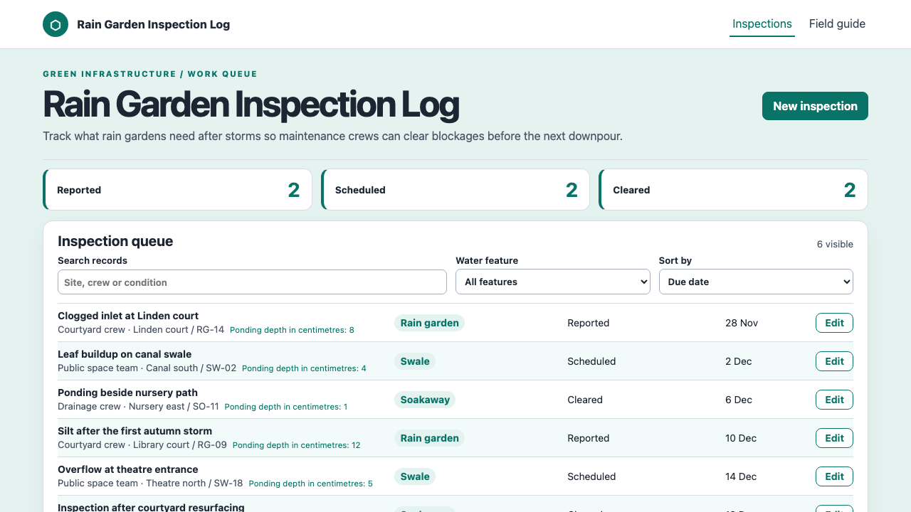
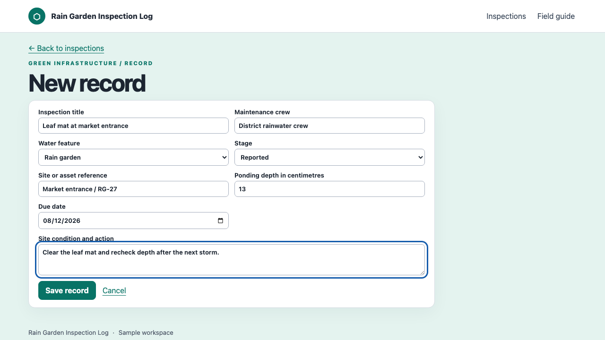

# Rain Garden Inspection Log

Track what rain gardens need after storms so maintenance crews can clear blockages before the next downpour.

## Live demo

[Watch the recorded walkthrough](docs/demo.webm). Follow the installation steps to try it locally.

## Screenshots

## Main features

- Find records by title, owner, reference, stage or notes. Filter by water feature and sort by title or due date.
- Create and edit records with a checked ponding depth in centimetres value and a due date.
- See counts by stage, follow the field guide, and record evidence before closing a review.

## Technology used

React, TypeScript, Java 21, Spring Boot, JDBC and H2.

## Installation instructions

Use Node.js 24, Java 21 and Maven. From `backend/` run `mvn spring-boot:run`. From the project root run `npm ci` and `npm run dev`. Open the address printed by the frontend.

## Commercial licensing/contact

Contact [Amitesh2022](https://github.com/Amitesh2022) for commercial licensing.

## Business problem and users

Municipal parks teams and contractors need a reliable record of what they find during post-storm inspections. [Official background](https://www.brussels.be/rainbow-project).

## Key workflows

Open the queue, filter for a relevant record, create or revise it, then move it to the next stage. Only mark the inspection cleared once the crew records what changed and when the site was checked again.

## Framework highlights

React hooks manage the subscription and memoise the filtered list and stage counts.

## Java backend highlights

Spring Boot separates the HTTP API, validation and JDBC repository. It provides list and search, create and update, structured validation errors and a health endpoint. Records are stored in a local H2 database.

## Architecture and state flow

The frontend reads `/api/records` through its development proxy. The API validates each change and returns the stored record, which updates the queue. The queue, record editor and guide have separate hash routes.

## Accessibility and responsive behaviour

The app has labelled fields, visible focus, status announcements and text stage labels. Filters and records stack on narrow screens.

## Verification commands

- `npm test`, `npm run lint` and `npm run build`.
- `cd backend && mvn verify`.

## Structure

- `src/`: frontend, view state and tests.
- `backend/`: service, repository, database schema and Java integration tests.
- `docs/`: screenshots and walkthrough.

## Tradeoffs

This is a sample workspace, not an official or hosted service. Seed records are fictional. H2 simplifies local setup; sign-in and audit history are not included. Only mark the inspection cleared once the crew records what changed and when the site was checked again.

## Roadmap

Add geotagged inspection photographs, crew assignment history and post-storm reports.
